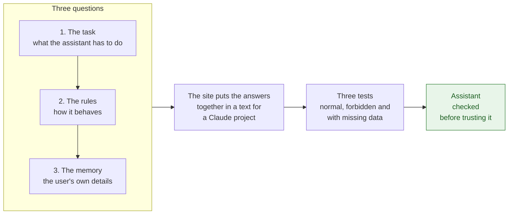

Versión en español: [README.md](README.md)

# Your first AI assistant

> A free website that teaches you to write the instructions that turn Claude into your own assistant, with a task, a set of rules and the details of the person using it. No coding needed.

**This is a prototype.** It is an educational guide and a starting point, not a finished product. It will grow with use. This repository holds **the website's code**, built with Astro. It also holds this explanation of what it solves and how it connects to the rest of my work.

## The problem it solves

Most people use AI for one-off tasks and explain the context in every conversation: what the task is, which tone to use and which limits apply. The website teaches you to write that context **once**, as instructions Claude applies in every conversation inside a project.

Everything is in plain language. If you can explain your job to a new colleague, you can do this. There is nothing to code or install. The website is free.

## What the website contains

A three-step walkthrough, one step per piece of the method:

- **The task**, which the website calls a *skill*: what the assistant has to do. Strictly speaking, a Claude skill is a `SKILL.md` file that Claude loads when a task matches its description. The website prepares the same content to paste into a project's instructions. At the end it also downloads it as a skill, in a `.zip` ready to upload to claude.ai.
- **The rules**: how it behaves in any task, with the way it addresses its user kept apart from the tone of what it writes for other people.
- **The memory**: the details about the user it has to take into account.

At the end, the website puts the answers together in a text you paste into a Claude project; a free account is enough. **The website is not the AI**: it teaches and prepares the text. Claude is what uses it.

Along with the text, the website suggests **three tests** built from each person's answers: a normal case, one that asks for something it must not do and one with a missing detail. They check the assistant before you trust it and are repeated after every change.

It also includes the same task answered **with and without instructions** (hand-written examples), a page on **the method** and on testing an assistant before trusting it, a **glossary** that explains every term with a comparison, and **three levels**: a skill, a swarm of skills that share one task, and a swarm of swarms, with one for each area of a company.

## How it's built

- Astro, a static-site generator: fast HTML pages that need no server of their own.
- No backend and no keys: everything happens in the browser. What you type is stored in the browser's *localStorage* on your own device. It is never sent anywhere.
- **15 pages**, with content kept apart from structure so the text can be fixed without touching the design.
- Published on **Vercel**, which republishes it whenever this repository changes.

Because it is static, with no backend and no credentials, it handles no sensitive data or secrets.

## How it relates to the rest of my work

This website is the plain-language entry point to concepts that other repositories build and test in code: `accounting-agent-swarm`, `verificacion-determinista-ia`, `gobernanza-skills-analiticas`, `agent-memory-governance` and `llm-eval-contable`, linked above.

## Status

A prototype in progress, published to share the approach, not as a finished product. Feedback is welcome.

## Live site

The site is live at **https://tu-primer-asistente-ia-web.vercel.app/**

## License

The website's code and this explanation are published under the MIT license (see [LICENSE](LICENSE)).
