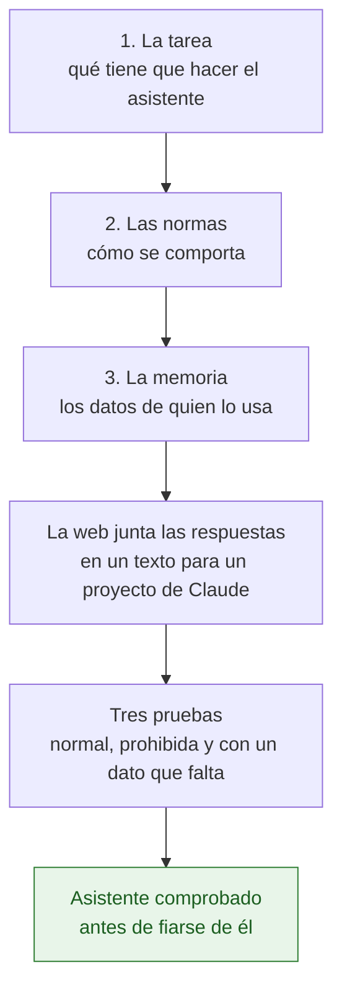

English version: [README.en.md](README.en.md)

# Tu primer asistente de IA

> Una web gratuita para aprender a escribir las instrucciones que convierten a Claude en un asistente propio, con una tarea, unas normas y los datos de quien lo usa. No hace falta programar.

**Es un prototipo.** Es una guía formativa y un punto de partida, no un producto terminado. Se irá ampliando con el uso. Este repositorio contiene **el código de la web**, hecha con Astro. También contiene esta explicación de qué resuelve y de cómo se relaciona con el resto de mi trabajo.

---

## Qué problema resuelve

Lo habitual es usar la IA para tareas sueltas y explicarle el contexto en cada conversación: qué tarea es, con qué tono y con qué límites. La web enseña a escribir ese contexto **una sola vez**, en unas instrucciones que Claude aplica en todas las conversaciones de un proyecto.

Todo está en lenguaje normal. Quien sabe explicarle su trabajo a un compañero nuevo tiene lo necesario para hacerlo. No hay que programar ni instalar nada. La web es gratuita.

## Qué hay en la web

Un recorrido en tres pasos, uno por cada pieza del método:

- **La tarea**, que la web llama *skill*: qué tiene que hacer el asistente. En sentido estricto, una skill de Claude es un archivo `SKILL.md` que Claude carga cuando la tarea encaja con su descripción. La web prepara el mismo contenido para pegarlo en las instrucciones de un proyecto. Al final también lo descarga como skill, en un `.zip` listo para subir a claude.ai.
- **Las normas**: cómo se comporta en cualquier tarea, con el trato a quien lo usa separado del de los textos que escribe para otras personas.
- **La memoria**: los datos de quien lo usa que tiene que tener en cuenta.

Al final, la web junta las respuestas en un texto que se copia en un proyecto de Claude. Sirve la cuenta gratuita. **La web no es la IA**: enseña y prepara el texto. Quien lo usa es Claude.

Con el texto, la web propone **tres pruebas** montadas con las respuestas de cada persona: un caso normal, uno que le pide lo que no debe hacer y uno al que le falta un dato. Sirven para comprobar el asistente antes de fiarse de él y se repiten después de cada cambio.

Además del recorrido, la web incluye:

- La misma tarea resuelta **con y sin instrucciones**, con respuestas escritas a mano para mostrar la diferencia.
- **El método**: lo que se suele creer que hace la IA frente a lo que se comprobó al montar un sistema contable. Explica también cómo se prueba un asistente antes de confiar en él.
- **Un glosario** con cada palabra que usa la guía (skill, CLAUDE.md, Markdown, agente, enjambre y otras), explicada con una comparación.
- **Tres niveles**, de menos a más: una skill, un enjambre de skills que se reparten una tarea y un enjambre de enjambres, con uno para cada área de la empresa. Para empezar basta el primero. Los otros dos explican qué se monta cuando una skill no basta.

## Cómo está hecha

- Astro, un generador de webs estáticas: produce páginas HTML que cargan rápido y no necesitan servidor propio.
- Sin servidor ni claves: todo ocurre en el navegador. Lo que se escribe se guarda en el *localStorage* del navegador, en el propio equipo. No se envía a ningún sitio.
- **15 páginas**, con el contenido separado de la estructura. Los textos están en archivos de datos aparte, para poder corregirlos sin tocar el diseño.
- Publicada en **Vercel**, que la vuelve a publicar cada vez que cambia este repositorio.

Como es estática y no tiene servidor ni credenciales, no maneja datos sensibles ni secretos.

## Cómo se relaciona con el resto de mi trabajo

Esta web es la puerta de entrada, en lenguaje llano, a conceptos que otros repositorios construyen y prueban con código:

- [**accounting-agent-swarm**](https://github.com/jleonceo/accounting-agent-swarm): un enjambre de agentes que se reparten una tarea contable de principio a fin. Es el ejemplo del nivel 2 de la web.
- [**verificacion-determinista-ia**](https://github.com/jleonceo/verificacion-determinista-ia): código que comprueba la coherencia del sistema **sin** depender de la IA.
- [**gobernanza-skills-analiticas**](https://github.com/jleonceo/gobernanza-skills-analiticas): cómo se evita que un asistente empeore sin que nadie lo note, con respuestas de referencia, pruebas de no regresión y autonomía según el riesgo. Es la base de la página del método.
- [**agent-memory-governance**](https://github.com/jleonceo/agent-memory-governance): cómo se mantiene ordenada la memoria de un asistente.
- [**llm-eval-contable**](https://github.com/jleonceo/llm-eval-contable): cómo se evalúa un asistente como a un alumno, con su nota medida.

## Estado

Prototipo en evolución. Se publica para compartir el enfoque, no como producto cerrado. Las sugerencias son bienvenidas.

## Ver la web

La web está publicada en **https://tu-primer-asistente-ia-web.vercel.app/**

## Licencia

El código de esta web y esta explicación se publican con licencia MIT (ver [LICENSE](LICENSE)).
